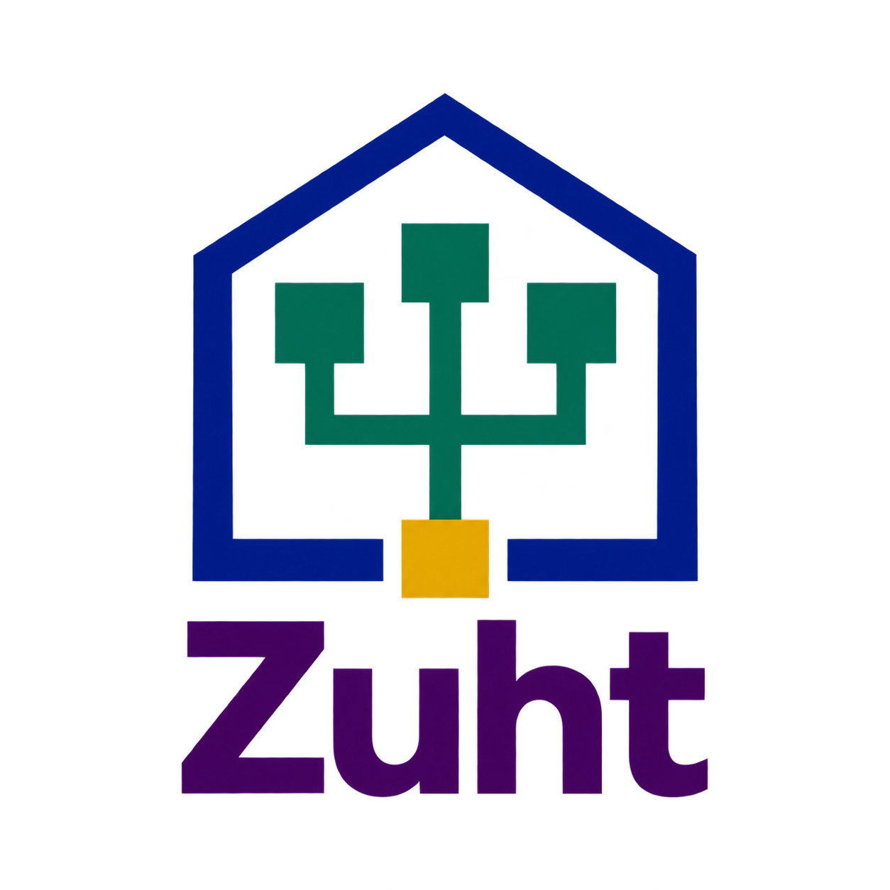

# Zuht

Pronounced /tsʊxt/. That’s how I say it, but you’re free to pronounce it your own way.

Zuht is a personal software factory I’m developing to help manage scope and complexity in software development. It is currently under development.

The main goals are:

- Full control over agents and subagents, with transparency into their actions.
- Agent self-education and improvement under strict human control.
- Independence from any particular harness or agent implementation.
- Control and time efficiency, even at the cost of some automation and unattended operation.
